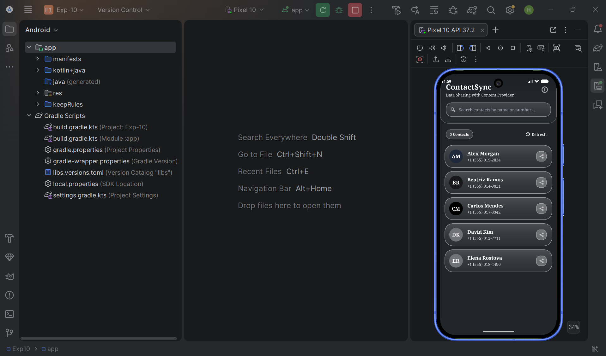
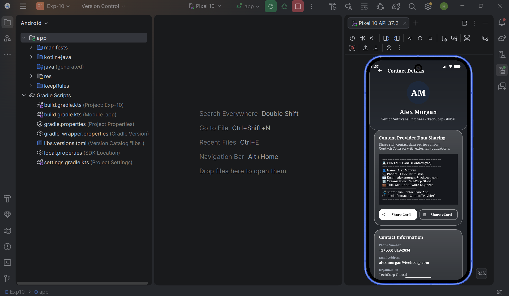

# 📱 ContactSync – Data Sharing with Content Provider

An Android application demonstrating how to access, sync, and share data using Android's **Contacts Content Provider** (`ContactsContract.CommonDataKinds.Phone`), **`ContentResolver`**, **`ContentObserver`**, and implicit **Intents**.

---

## 🎨 Features & Highlights

- **Glassmorphic UI Design**: Custom dark charcoal glass panels with specular edge reflections and Times New Roman typography.
- **Content Provider Querying**: Queries real contacts from `ContactsContract.CommonDataKinds.Phone.CONTENT_URI` asynchronously using `ExecutorService` and `Handler`.
- **Live Content Observer**: Registers a `ContentObserver` on the contacts URI to auto-detect and display new contacts added to the phonebook in real-time.
- **Rich Data Sharing**: Demonstrates sharing contact cards in plain text (`text/plain`) and vCard (`text/x-vcard`) formats via `Intent.ACTION_SEND`.
- **Real-Time Search & Filtering**: Filters contacts dynamically by name or phone number.
- **Robust Back Navigation**: Dedicated back navigation with `OnBackPressedCallback`, toolbar clicks, and `finish()` fallbacks.

---

## 🏗️ System Structure

```
Exp10/
├── app/
│   ├── src/main/
│   │   ├── java/com/example/exp_10/
│   │   │   ├── Contact.java                       # Data Model with vCard & Share format helpers
│   │   │   ├── ContactAdapter.java                # RecyclerView Adapter with Filterable search
│   │   │   ├── MainActivity.java                  # Main Dashboard, ContentResolver & ContentObserver
│   │   │   ├── ContactDetailActivity.java         # Detailed Contact View & Data Sharing Intent
│   │   │   └── ContentProviderInfoActivity.java    # Educational Guide on Content Providers
│   │   ├── res/
│   │   │   ├── layout/
│   │   │   │   ├── activity_main.xml              # Main Dashboard Glass Layout
│   │   │   │   ├── item_contact.xml               # Glass Contact Card Item Layout
│   │   │   │   ├── activity_contact_detail.xml    # Contact Details Glass Layout
│   │   │   │   └── activity_content_provider_info.xml # Info Guide Glass Layout
│   │   │   ├── drawable/
│   │   │   │   ├── bg_glass_card.xml              # Specular Glass Card Drawable
│   │   │   │   ├── bg_glass_search.xml            # Glass Search Bar Drawable
│   │   │   │   ├── bg_badge.xml                   # Glass Pill Badge Drawable
│   │   │   │   ├── bg_avatar_circle.xml           # Glass Avatar Drawable
│   │   │   │   ├── gradient_header.xml            # Header Glass Gradient
│   │   │   │   └── ic_arrow_back.xml              # Back Navigation Vector Icon
│   │   │   └── values/
│   │   │       ├── colors.xml                     # Dark Glass Palette
│   │   │       ├── strings.xml                    # App Text Resources
│   │   │       └── themes.xml                     # Times New Roman (Serif) App Theme
│   │   └── AndroidManifest.xml                    # Permissions & Activity Declarations
├── 1.png                                          # Main Dashboard Output Screenshot
├── 2.png                                          # Contact Details Output Screenshot
└── README.md                                      # Documentation File
```

---

## 💻 Source Code Overview

### 1. `AndroidManifest.xml`
```xml
<?xml version="1.0" encoding="utf-8"?>
<manifest xmlns:android="http://schemas.android.com/apk/res/android">

    <uses-permission android:name="android.permission.READ_CONTACTS" />

    <application
        android:allowBackup="true"
        android:icon="@mipmap/ic_launcher"
        android:label="@string/app_name"
        android:theme="@style/Theme.Exp10">

        <activity
            android:name=".MainActivity"
            android:exported="true">
            <intent-filter>
                <action android:name="android.intent.action.MAIN" />
                <category android:name="android.intent.category.LAUNCHER" />
            </intent-filter>
        </activity>

        <activity
            android:name=".ContactDetailActivity"
            android:exported="false" />

        <activity
            android:name=".ContentProviderInfoActivity"
            android:exported="false" />

    </application>

</manifest>
```

### 2. `Contact.java` (Model)
```java
package com.example.exp_10;

import android.graphics.Color;
import java.io.Serializable;

public class Contact implements Serializable {
    private String id, name, phoneNumber, email, company, jobTitle, photoUri;

    public Contact(String id, String name, String phoneNumber, String email, String company, String jobTitle, String photoUri) {
        this.id = id != null ? id : "";
        this.name = (name != null && !name.trim().isEmpty()) ? name : "Unknown Contact";
        this.phoneNumber = (phoneNumber != null && !phoneNumber.trim().isEmpty()) ? phoneNumber : "No Phone Number";
        this.email = (email != null && !email.trim().isEmpty()) ? email : name.toLowerCase().replaceAll("[^a-z0-9]", "") + "@contactsync.org";
        this.company = (company != null && !company.trim().isEmpty()) ? company : "ContactSync Network";
        this.jobTitle = (jobTitle != null && !jobTitle.trim().isEmpty()) ? jobTitle : "Verified Contact";
        this.photoUri = photoUri;
    }

    public String getName() { return name; }
    public String getPhoneNumber() { return phoneNumber; }
    public String getEmail() { return email; }
    public String getCompany() { return company; }
    public String getJobTitle() { return jobTitle; }

    public String getFormattedShareText() {
        return "==================================\n" +
               "📇 CONTACT CARD (ContactSync)\n" +
               "==================================\n" +
               "👤 Name: " + name + "\n" +
               "📞 Phone: " + phoneNumber + "\n" +
               "📧 Email: " + email + "\n" +
               "🏢 Organization: " + company + "\n" +
               "💼 Title: " + jobTitle + "\n" +
               "----------------------------------\n" +
               "📲 Shared via ContactSync App\n" +
               "(Android Contacts ContentProvider)\n" +
               "==================================";
    }

    public String getVCardText() {
        return "BEGIN:VCARD\nVERSION:3.0\nFN:" + name + "\nTEL;TYPE=CELL:" + phoneNumber +
               "\nEMAIL:" + email + "\nORG:" + company + "\nEND:VCARD";
    }

    public String getInitials() {
        String[] parts = name.trim().split("\\s+");
        if (parts.length >= 2) return (parts[0].substring(0, 1) + parts[1].substring(0, 1)).toUpperCase();
        return name.length() >= 2 ? name.substring(0, 2).toUpperCase() : name.toUpperCase();
    }

    public int getAvatarColor() {
        String[] colors = {"#000000", "#18181B", "#27272A", "#3F3F46", "#52525B", "#71717A", "#1E293B"};
        return Color.parseColor(colors[Math.abs(name.hashCode()) % colors.length]);
    }
}
```

### 3. `MainActivity.java` (Query & ContentObserver)
```java
package com.example.exp_10;

import android.Manifest;
import android.content.Intent;
import android.content.pm.PackageManager;
import android.database.ContentObserver;
import android.database.Cursor;
import android.net.Uri;
import android.os.Bundle;
import android.os.Handler;
import android.os.Looper;
import android.provider.ContactsContract;
import androidx.appcompat.app.AppCompatActivity;
import androidx.core.content.ContextCompat;
import java.util.ArrayList;
import java.util.List;

public class MainActivity extends AppCompatActivity {

    private final Handler mainHandler = new Handler(Looper.getMainLooper());
    private final ContentObserver contactsObserver = new ContentObserver(mainHandler) {
        @Override
        public void onChange(boolean selfChange) {
            loadContactsFromContentProvider();
        }
    };

    @Override
    protected void onResume() {
        super.onResume();
        if (ContextCompat.checkSelfPermission(this, Manifest.permission.READ_CONTACTS) == PackageManager.PERMISSION_GRANTED) {
            getContentResolver().registerContentObserver(
                ContactsContract.CommonDataKinds.Phone.CONTENT_URI, true, contactsObserver);
            loadContactsFromContentProvider();
        }
    }

    private void loadContactsFromContentProvider() {
        Uri phoneUri = ContactsContract.CommonDataKinds.Phone.CONTENT_URI;
        String[] projection = new String[]{
            ContactsContract.CommonDataKinds.Phone.CONTACT_ID,
            ContactsContract.CommonDataKinds.Phone.DISPLAY_NAME,
            ContactsContract.CommonDataKinds.Phone.NUMBER
        };

        try (Cursor cursor = getContentResolver().query(phoneUri, projection, null, null, null)) {
            List<Contact> contacts = new ArrayList<>();
            while (cursor != null && cursor.moveToNext()) {
                String name = cursor.getString(cursor.getColumnIndexOrThrow(ContactsContract.CommonDataKinds.Phone.DISPLAY_NAME));
                String number = cursor.getString(cursor.getColumnIndexOrThrow(ContactsContract.CommonDataKinds.Phone.NUMBER));
                contacts.add(new Contact(null, name, number, null));
            }
            // Update UI list on mainHandler
        } catch (Exception e) {
            e.printStackTrace();
        }
    }

    @Override
    protected void onPause() {
        super.onPause();
        getContentResolver().unregisterContentObserver(contactsObserver);
    }
}
```

### 4. `ContactDetailActivity.java` (Data Sharing)
```java
package com.example.exp_10;

import android.content.Intent;
import android.os.Bundle;
import android.view.View;
import androidx.appcompat.app.AppCompatActivity;

public class ContactDetailActivity extends AppCompatActivity {

    private Contact contact;

    @Override
    protected void onCreate(Bundle savedInstanceState) {
        super.onCreate(savedInstanceState);
        setContentView(R.layout.activity_contact_detail);

        contact = (Contact) getIntent().getSerializableExtra("extra_contact");

        findViewById(R.id.btnShareContact).setOnClickListener(v -> {
            Intent shareIntent = new Intent(Intent.ACTION_SEND);
            shareIntent.setType("text/plain");
            shareIntent.putExtra(Intent.EXTRA_SUBJECT, "Contact Card: " + contact.getName());
            shareIntent.putExtra(Intent.EXTRA_TEXT, contact.getFormattedShareText());
            startActivity(Intent.createChooser(shareIntent, "Share Card via"));
        });
    }

    public void onBackClicked(View view) {
        finish();
    }
}
```

---

## 🖼️ Application Output Screenshots

### 1. Main Dashboard View (`1.png`)
The main dashboard displays system contacts retrieved via `ContentResolver`, total contact count badge, search filter, and glossy Glassmorphism cards.



---

### 2. Contact Details & Data Sharing (`2.png`)
The Contact Details screen displays complete contact information, live text card share preview, and action buttons for sharing formatted cards and vCards.


