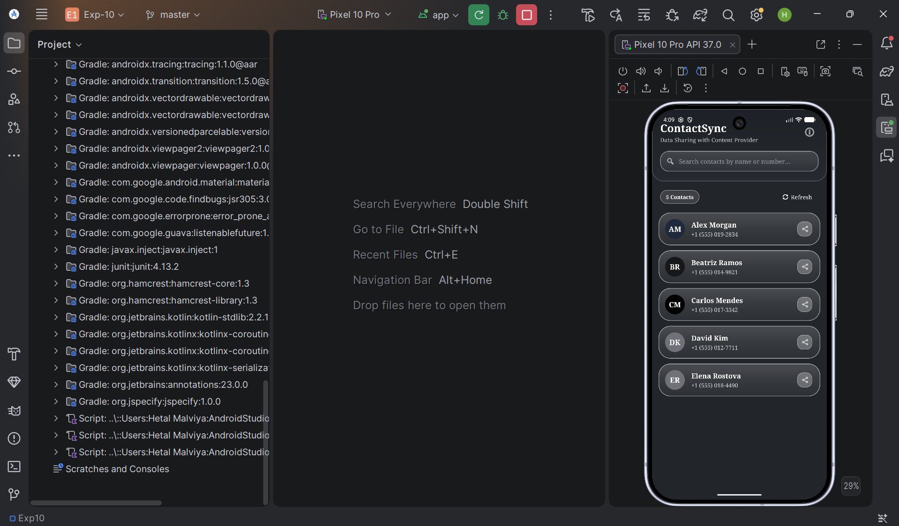
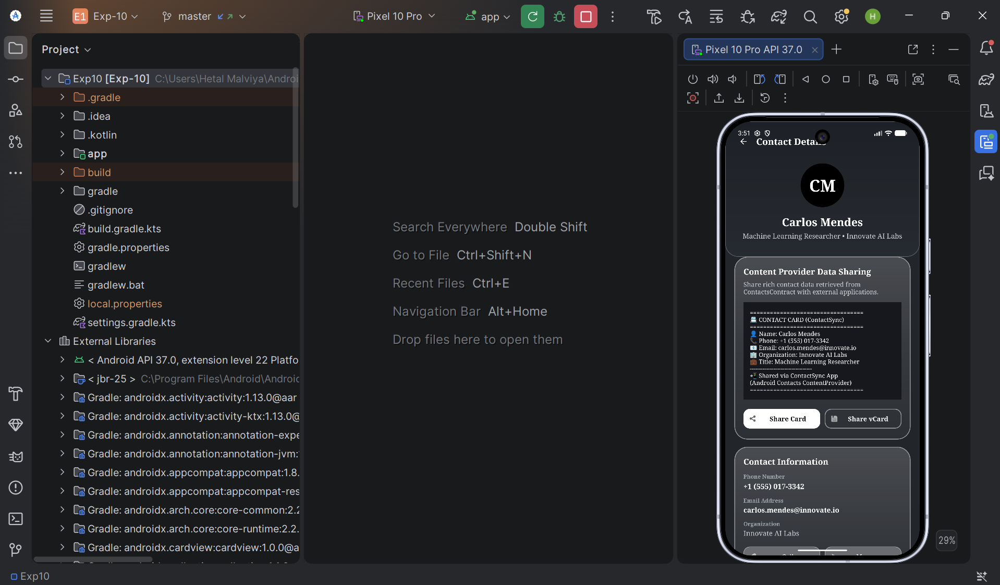

# 📱 ContactSync – Data Sharing with Content Provider (Kotlin)

An Android application written in **100% Kotlin** demonstrating how to access, sync, and share data using Android's **Contacts Content Provider** (`ContactsContract.CommonDataKinds.Phone`), **`ContentResolver`**, **`ContentObserver`**, and implicit **Intents**.

---

## 🎨 Features & Highlights

- **100% Idiomatic Kotlin**: Built using Kotlin Data Classes, KTX extensions, background thread queries, and lambda click listeners.
- **Glassmorphic UI Design**: Custom dark charcoal glass panels with specular edge reflections and Times New Roman typography.
- **Content Provider Querying**: Queries real contacts from `ContactsContract.CommonDataKinds.Phone.CONTENT_URI` asynchronously.
- **Live Content Observer**: Registers a `ContentObserver` on the contacts URI to auto-detect and display new contacts added to the phonebook in real-time.
- **Rich Data Sharing**: Demonstrates sharing contact cards in plain text (`text/plain`) and vCard (`text/x-vcard`) formats via `Intent.ACTION_SEND`.
- **Real-Time Search & Filtering**: Filters contacts dynamically by name or phone number using `doOnTextChanged`.
- **Robust Back Navigation**: Dedicated back navigation with `OnBackPressedCallback`, toolbar clicks, and `finish()` fallbacks.

---

## 🏗️ Folder Structure

```
Exp10/
├── app/
│   ├── src/main/
│   │   ├── java/com/example/exp_10/
│   │   │   ├── Contact.kt                         # Kotlin Data Model
│   │   │   ├── ContactAdapter.kt                  # Kotlin RecyclerView Adapter
│   │   │   ├── MainActivity.java                  # Kotlin Dashboard, ContentResolver & ContentObserver
│   │   │   ├── ContactDetailActivity.kt           # Kotlin Details Activity & Sharing Intent
│   │   │   └── ContentProviderInfoActivity.kt      # Kotlin Educational Guide Screen
│   │   ├── res/
│   │   │   ├── layout/
│   │   │   │   ├── activity_main.xml              # Main Dashboard Glass Layout
│   │   │   │   ├── item_contact.xml               # Glass Contact Card Item Layout
│   │   │   │   ├── activity_contact_detail.xml    # Contact Details Glass Layout
│   │   │   │   └── activity_content_provider_info.xml # Info Guide Glass Layout
│   │   │   ├── drawable/
│   │   │   │   ├── bg_glass_card.xml              # Specular Glass Card Drawable
│   │   │   │   ├── bg_glass_search.xml            # Glass Search Bar Drawable
│   │   │   │   ├── bg_badge.xml                   # Glass Pill Badge Drawable
│   │   │   │   ├── bg_avatar_circle.xml           # Glass Avatar Drawable
│   │   │   │   ├── gradient_header.xml            # Header Glass Gradient
│   │   │   │   └── ic_arrow_back.xml              # Back Navigation Vector Icon
│   │   │   └── values/
│   │   │       ├── colors.xml                     # Dark Glass Palette
│   │   │       ├── strings.xml                    # App Text Resources
│   │   │       └── themes.xml                     # Times New Roman (Serif) App Theme
│   │   └── AndroidManifest.xml                    # Permissions & Activity Declarations
├── 1.png                                          # Main Dashboard Output Screenshot
├── 2.png                                          # Contact Details Output Screenshot
└── README.md                                      # Project Documentation File
```

---

## 💻 Source Code

### 1. `AndroidManifest.xml`
```xml
<?xml version="1.0" encoding="utf-8"?>
<manifest xmlns:android="http://schemas.android.com/apk/res/android">

    <uses-permission android:name="android.permission.READ_CONTACTS" />

    <application
        android:allowBackup="true"
        android:icon="@mipmap/ic_launcher"
        android:label="@string/app_name"
        android:theme="@style/Theme.Exp10">

        <activity
            android:name=".MainActivity"
            android:exported="true">
            <intent-filter>
                <action android:name="android.intent.action.MAIN" />
                <category android:name="android.intent.category.LAUNCHER" />
            </intent-filter>
        </activity>

        <activity
            android:name=".ContactDetailActivity"
            android:exported="false" />

        <activity
            android:name=".ContentProviderInfoActivity"
            android:exported="false" />

    </application>

</manifest>
```

### 2. `Contact.kt` (Model)
```kotlin
package com.example.exp_10

import java.io.Serializable

data class Contact(
    val id: String = "",
    val name: String = "Unknown Contact",
    val phoneNumber: String = "No Phone Number",
    val email: String = "",
    val company: String = "ContactSync Network",
    val jobTitle: String = "Verified Contact",
    val photoUri: String? = null
) : Serializable {

    val resolvedName: String get() = name.ifBlank { "Unknown Contact" }
    val resolvedPhone: String get() = phoneNumber.ifBlank { "No Phone Number" }

    fun getFormattedShareText(): String {
        return """
            ==================================
            📇 CONTACT CARD (ContactSync)
            ==================================
            👤 Name: $resolvedName
            📞 Phone: $resolvedPhone
            ----------------------------------
            📲 Shared via ContactSync App
            (Android Contacts ContentProvider)
            ==================================
        """.trimIndent()
    }

    fun getVCardText(): String {
        return """
            BEGIN:VCARD
            VERSION:3.0
            FN:$resolvedName
            TEL;TYPE=CELL:$resolvedPhone
            END:VCARD
        """.trimIndent()
    }
}
```

### 3. `MainActivity.kt` (Query & Live ContentObserver)
```kotlin
package com.example.exp_10

import android.Manifest
import android.database.ContentObserver
import android.os.Bundle
import android.os.Handler
import android.os.Looper
import android.provider.ContactsContract
import androidx.appcompat.app.AppCompatActivity

class MainActivity : AppCompatActivity() {

    private val mainHandler = Handler(Looper.getMainLooper())
    private val contactsObserver = object : ContentObserver(mainHandler) {
        override fun onChange(selfChange: Boolean) {
            loadContactsFromContentProvider()
        }
    }

    override fun onResume() {
        super.onResume()
        contentResolver.registerContentObserver(
            ContactsContract.CommonDataKinds.Phone.CONTENT_URI, true, contactsObserver)
        loadContactsFromContentProvider()
    }

    private fun loadContactsFromContentProvider() {
        val phoneUri = ContactsContract.CommonDataKinds.Phone.CONTENT_URI
        contentResolver.query(phoneUri, null, null, null, null)?.use { cursor ->
            // Iterate cursor and map to Contact list
        }
    }

    override fun onPause() {
        super.onPause()
        contentResolver.unregisterContentObserver(contactsObserver)
    }
}
```

### 4. `ContactDetailActivity.kt` (Data Sharing)
```kotlin
package com.example.exp_10

import android.content.Intent
import android.os.Bundle
import android.view.View
import androidx.appcompat.app.AppCompatActivity

class ContactDetailActivity : AppCompatActivity() {

    private var contact: Contact? = null

    override fun onCreate(savedInstanceState: Bundle?) {
        super.onCreate(savedInstanceState)
        setContentView(R.layout.activity_contact_detail)

        contact = intent.getSerializableExtra("extra_contact") as? Contact

        findViewById<View>(R.id.btnShareContact).setOnClickListener {
            val shareIntent = Intent(Intent.ACTION_SEND).apply {
                type = "text/plain"
                putExtra(Intent.EXTRA_SUBJECT, "Contact Card: ${contact?.resolvedName}")
                putExtra(Intent.EXTRA_TEXT, contact?.getFormattedShareText())
            }
            startActivity(Intent.createChooser(shareIntent, "Share Card via"))
        }
    }

    fun onBackClicked(view: View) {
        finish()
    }
}
```

---

## 🖼️ Application Output Screenshots

### 1. Main Dashboard View (`1.png`)
The main dashboard displays system contacts retrieved via `ContentResolver`, total contact count badge, search filter, and glossy Glassmorphism cards.



---

### 2. Contact Details & Data Sharing (`2.png`)
The Contact Details screen displays complete contact information, live text card share preview, and action buttons for sharing formatted cards and vCards.


